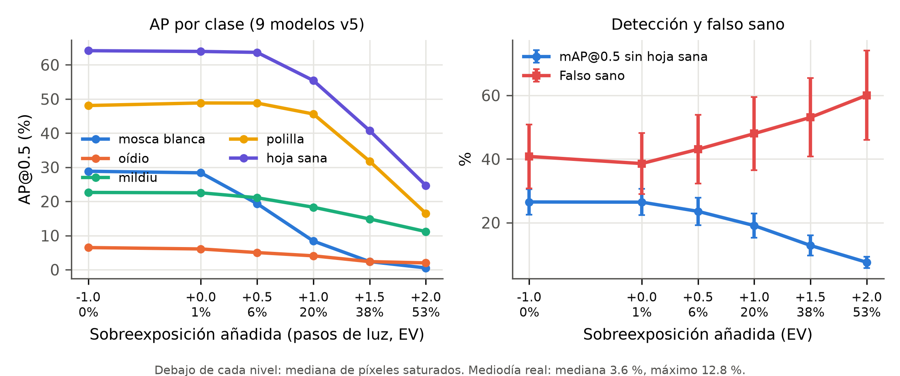

# Plan: medir y atacar la radiación solar (foco de la investigación), 16/11/2026

Decisión: la radiación pasa a ser el aporte central del trabajo (ruta "a" de la obs. 1 del revisor).
Tres partes: **medir** cuánta luz hay y cómo cambia la foto, **mostrar** cómo se comporta el detector, y
**tratar** el problema (mitigación) comprobando qué funciona.

## 1. Lo que ya sabemos (datos actuales)

| Medida | Mañana | Mediodía | Tarde | Fuente |
|---|---|---|---|---|
| Píxeles saturados (mediana, 1966 img.) | 0.8 % | **3.6 %** | 1.0 % | `a3_exposicion.py` |
| Contraste (DE de luminancia) | 48.7 | **58.8** | 51.0 | `a3_exposicion.py` |
| Luz de escena de la cámara, Bv EXIF (mayo; +1 = el doble) | 5.89 | **6.47** | 4.57 | `a7_exif_luz.py` |

- El Bv del EXIF existe en 1584 de las 1966 fotos (los cuadros de video no tienen EXIF) y se correlaciona
  con la saturación (Spearman 0.47) y el contraste (0.59). Mide la luz **reflejada por la escena**, no la
  irradiancia: sirve como medida relativa, no en lux.
- **Con las fotos actuales no hay relación clara entre luz y acierto**: saturación OR 0.82 (p = 0.11), Bv
  OR 0.91–1.06 (p > 0.6). Pero el diseño no permite verlo: el mediodía solo existe el 3 de mayo y cada
  franja tiene plantas y clases distintas.
- La app ya tiene un aviso "Mucha luz" (`scanner_page.dart`: brillo medio > 200 o > 15 % de píxeles > 240),
  con umbrales elegidos a ojo y nunca validados.

## 2. Prueba de estrés (sin salir al campo)

Las 180 fotos de prueba se sobreexponen artificialmente (+0.5 a +2 pasos de luz, con recorte de píxeles
quemados) y se mide la caída del detector: muestra **causalmente** cuánto le afecta el brillo, porque es
la misma foto con más luz. Resultados en la sección 6 (`a8_estres_exposicion.py`).

## 3. Protocolo de campo (salida de la próxima semana)

**Idea central: fotografiar las MISMAS hojas en las tres franjas del MISMO día.** Así la única diferencia
entre fotos es la luz (diseño pareado), que es lo que hoy falta.

**Preparación**
- Elegir **30–40 plantas**, priorizando las que tengan oídio, mosca blanca y polilla (las clases flojas).
  Marcar cada planta con una estaca o cinta con su número (P01, P02, …) y, dentro de cada planta, 2–3 hojas
  con un clip o cinta de color.
- Llevar una **tarjeta blanca o gris** (cartulina; si se consigue, carta gris 18 %) que aparezca en una foto
  por planta y franja: permite medir la exposición real de la escena.
- **Luxómetro digital** (de mano, ~S/ 50–80; que llegue a 100 000 lux o más). Si no se consigue, la app de
  sensores del celular (p. ej. Physics Toolbox) como respaldo, sabiendo que muchos celulares se saturan con
  sol directo.

**En cada franja (08:00–09:30, 12:00–13:30, 16:00–17:30), para cada planta**
1. Medir la luz con el luxómetro horizontal a la altura de las hojas y anotarla en una planilla
   (planta, hora, lux, nubosidad: despejado / parcial / nublado).
2. Foto de la tarjeta junto a la planta (con el número visible).
3. 3–5 fotos de las hojas marcadas a 15–20 cm, en modo automático (como lo haría el agricultor), sin flash.
4. **Solo al mediodía:** repetir 2 fotos **dándole sombra** a la hoja con el cuerpo o un paraguas. Sirve
   para probar en campo la recomendación más simple para mitigar.

**Ideal: repetirlo en 2 días distintos** (para separar el efecto de la luz del efecto del día). Una sesión
con mediodía en otra fecha ya resuelve el problema principal que señaló el revisor.

**Datos externos de radiación (gratis, para el artículo):**
- **NASA POWER** (https://power.larc.nasa.gov): irradiancia global horaria (W/m²) por coordenadas del fundo,
  para todas las fechas de captura (mayo, julio y la nueva). Da un valor comparable con la literatura.
- Estación de SENAMHI más cercana a Majes, si tiene datos horarios de radiación (verificar disponibilidad).
- La hora y el Bv de cada foto se leen solos del EXIF.

**Etiquetado:** las fotos nuevas se etiquetan con las reglas corregidas (`12_correccion_etiquetas.md`) y se
asignan **por planta** a prueba (todas las fotos de una planta en el mismo subconjunto). Es mejor que todo el
conjunto pareado vaya a **prueba**: es la prueba de radiación del artículo.

## 4. Análisis previsto

1. **Efecto de la franja en la misma hoja:** acierto, falso sano y AP por franja con las mismas hojas
   (comparación pareada: McNemar y regresión logística de efectos mixtos con la planta como efecto aleatorio).
2. **Dosis-respuesta:** rendimiento frente a lux medidos, Bv del EXIF y % de saturación.
3. **Sombra frente a sol directo** al mediodía (misma hoja): ¿la sombra recupera el acierto?
4. **Validar el aviso "Mucha luz" de la app:** ¿las fotos que avisa son las que el modelo falla? Ajustar los
   umbrales con estos datos.

## 5. Mitigación: experimentos de entrenamiento (RTX 5070 Ti)

Todos con la misma partición y el mismo protocolo (3 semillas), evaluados en la prueba normal, en la prueba de
estrés y en la prueba pareada de campo:

| Experimento | Qué cambia | Qué responde |
|---|---|---|
| Base | v5 actual (aumento HSV por defecto, `hsv_v=0.4`) | Referencia |
| Aumento fotométrico | Más variación de brillo (`hsv_v=0.7`) y copias de entrenamiento sobreexpuestas sintéticamente (mismo método de la prueba de estrés), solo en entrenamiento | ¿Aprender con fotos "quemadas" hace al modelo robusto al sol? |
| Preprocesado | CLAHE (ecualización adaptativa del contraste) en entrenamiento y en la app | ¿Corregir la foto antes de detectar ayuda? |
| Guía en la app | Aviso validado "Mucha luz: dé sombra a la hoja" | ¿La recomendación práctica recupera el acierto en campo? |

El orden: primero la prueba de estrés y el protocolo de campo (definen cuánto afecta), luego el aumento
fotométrico (lo más barato y prometedor), después CLAHE.

## 6. Resultados de la prueba de estrés

Las 180 fotos de prueba con sobreexposición sintética; media de los 9 modelos v5 (`metricas/estres_exposicion.csv`):

| Exposición añadida | Píxeles saturados (mediana) | mAP@0.5 sin hoja sana | Falso sano | AP mosca blanca | AP oídio | AP polilla | AP hoja sana |
|---|---|---|---|---|---|---|---|
| −1 (subexpuesta) | 0 % | 26.5 | 41 % | 28.8 | 6.5 | 48.1 | 64.2 |
| 0 (original) | 1 % | 26.5 | 39 % | 28.4 | 6.1 | 48.8 | 63.9 |
| +0.5 | 6 % | 23.6 | 43 % | **19.4** | 5.0 | 48.8 | 63.7 |
| +1 | 20 % | 19.1 | 48 % | **8.4** | 4.1 | 45.6 | 55.4 |
| +1.5 | 38 % | 12.9 | 53 % | 2.4 | 2.4 | 31.8 | 40.7 |
| +2 | 53 % | 7.6 | 60 % | 0.5 | 2.0 | 16.5 | 24.7 |

**Qué muestra:**
1. **El brillo sí confunde al modelo, y lo hace de forma gradual (dosis-respuesta).** Con +1 paso de luz
   (20 % de píxeles quemados) el mAP de plagas cae 28 % (26.5 → 19.1) y el falso sano sube de 39 % a 48 %.
2. **La sombra o la oscuridad no afectan:** −1 paso no cambia nada. El problema es el exceso de luz.
3. **Lo más sensible es lo blanco:** la mosca blanca pierde un tercio de su AP con solo +0.5 pasos (6 % de
   saturación) y el 70 % con +1; el oídio (polvo blanco) también baja. Es la hipótesis del PPI: el blanco
   del insecto y del hongo se confunde con los reflejos y las zonas quemadas.
4. **La polilla resiste hasta +1** (lesiones oscuras); la hoja sana cae a partir de +1.
5. **Relación con el campo:** la mediana de saturación real al mediodía (3.6 %) está entre los niveles 0 y
   +0.5, y el máximo (12.8 %) entre +0.5 y +1. Es decir, las fotos actuales están en la zona donde la mosca
   blanca ya empieza a perderse; una hoja a pleno sol mal expuesta llega a la zona de caída fuerte.
6. Limitación: la sobreexposición sintética no reproduce reflejos especulares ni sombras duras; por eso hace
   falta la prueba pareada de campo (sección 3).

**Consecuencia para la mitigación:** el blanco objetivo son mosca blanca y oídio. El aumento fotométrico con
copias sobreexpuestas (sección 5) se puede evaluar directamente con esta misma prueba de estrés: si funciona,
la curva de mosca blanca debería caer menos.
